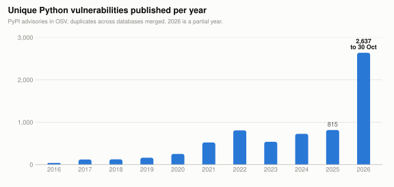
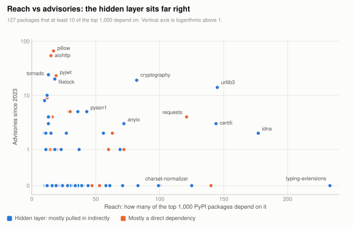
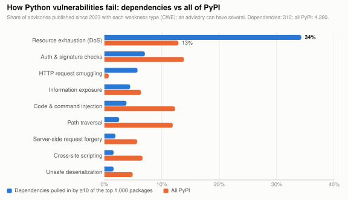

# Complexity in the Wild: What Python's Vulnerability Data Shows

[← Back to all pitfalls](../README.md)

The rest of this repo argues that Python's readable surface hides behavior you can't predict from the interface: *unknown unknowns*. This page tests that argument against data. It joins every Python vulnerability in the [OSV database](https://osv.dev) with the resolved dependency graphs of the 1,000 most-downloaded PyPI packages, PyPI's record of yanked releases, and OpenSSF Scorecard maintenance scores.

The result is organized by **mechanism**: the kind of hidden complexity that produced each vulnerability. Each section links to the pitfalls that show that mechanism in a few lines of code.

The scripts, a CSV snapshot and the chart source are in [`analysis/`](../analysis/), so every number and chart can be regenerated. *Snapshot: 30 October 2026. PyPI download rankings from 1 October 2026 (30-day window).*

## Key findings

1. **Most of your exposure is code you never chose.** `urllib3`, `certifi`, `idna`, `cryptography`, `anyio` and `pyasn1` are each pulled in by 43–177 of the top 1,000 packages, 70–95% of the time *indirectly*. Weighted by reach, `urllib3` and `cryptography` are the highest-exposure dependencies on PyPI.
2. **Libraries fail at the parsing boundary.** 34% of vulnerabilities in widely used dependencies are resource exhaustion (ReDoS, decompression bombs, unbounded allocation, deep recursion), against 13% across PyPI. Applications fail through path traversal, injection and SSRF instead.
3. **Conveniences hide decisions.** Following redirects, trusting a certificate bundle, parsing HTTP framing: each looks like plumbing, and each has produced a run of CVEs in the libraries that do it for you.
4. **The layer below Python is a bug source of its own.** Pillow's C decoders lead PyPI libraries with 119 advisories; `cryptography` inherits OpenSSL's; compiled extensions account for the segfaults and leaks behind many yanked releases.
5. **Known risk is growing fast, and it's measured by who looks.** 2026 has 2,637 unique advisories so far, more than three times any earlier year, arriving in audit-sized bursts. Meanwhile some of the most-depended-on packages have no advisories and weak maintenance signals.

<picture>
  <source media="(prefers-color-scheme: dark)" srcset="img/advisories-per-year-dark.svg">
  
</picture>

---

## 1. Code you never chose

A package's **reach** is the number of top-1,000 packages whose resolved dependency tree includes it. A package is in the **hidden layer** when more than half of that reach is indirect: it's a dependency of a dependency.

<picture>
  <source media="(prefers-color-scheme: dark)" srcset="img/reach-vs-advisories-dark.svg">
  
</picture>

The chart shows the shape of dependency risk. The packages with the most advisories (Pillow, aiohttp, PyJWT, Tornado) are ones people install deliberately. The packages with the most *reach* are infrastructure almost nobody installs on purpose. Weighting advisories since 2023 by reach combines the two:

| Package | Reach | Indirect | Vulns since 2023 | Of which 2026 | Exposure | Top weaknesses |
|---|---:|---:|---:|---:|---:|---|
| `urllib3` | 145 | 86% | 14 | 6 | 2,030 | Information exposure, certificate validation |
| `cryptography` | 82 | 70% | 19 | 7 | 1,558 | NULL dereference, vulnerable bundled component |
| `pillow` | 17 | 18% | 66 | 60 | 1,122 | Out-of-bounds read, resource exhaustion |
| `aiohttp` | 15 | 27% | 54 | 40 | 810 | Unbounded allocation, request smuggling |
| `requests` | 121 | 49% | 4 | 1 | 484 | Information exposure, credential leaks |
| `pyjwt` | 19 | 47% | 23 | 21 | 437 | Improper signature verification |
| `certifi` | 144 | 87% | 3 | 1 | 432 | Insufficient authenticity verification |
| `filelock` | 18 | 56% | 20 | 19 | 360 | TOCTOU races, symlink following |
| `idna` | 177 | 95% | 2 | 1 | 354 | ReDoS, resource exhaustion |
| `tornado` | 13 | 54% | 24 | 15 | 312 | Resource exhaustion, unbounded allocation |
| `anyio` | 72 | 75% | 3 | 3 | 216 | Unbounded allocation, certificate validation |
| `pyasn1` | 43 | 88% | 5 | 5 | 215 | Resource exhaustion, algorithmic complexity |

Every hidden-layer package with reach of at least 20 and at least one advisory:

| Package | Download rank | Reach | Indirect | Vulns (all time) | Vulns in 2026 | High/critical | Scorecard |
|---|---:|---:|---:|---:|---:|---:|---:|
| `cryptography` | 9 | 82 | 70% | 24 | 7 | 12 | 8.3 |
| `urllib3` | 5 | 145 | 86% | 22 | 6 | 12 | 8.6 |
| `pygments` | 12 | 56 | 82% | 5 | 1 | 3 | 6.2 |
| `pyasn1` | 65 | 43 | 88% | 5 | 5 | 5 | 6.6 |
| `httpx2` | 129 | 36 | 75% | 5 | 5 | 2 | – |
| `certifi` | 6 | 144 | 87% | 4 | 1 | 2 | 6.3 |
| `anyio` | 22 | 72 | 75% | 3 | 3 | 2 | 5.6 |
| `idna` | 4 | 177 | 95% | 2 | 1 | 0 | 8.5 |
| `websockets` | 68 | 24 | 75% | 2 | 0 | 2 | 5.5 |
| `markdown-it-py` | 54 | 27 | 89% | 2 | 0 | 2 | 5.3 |
| `httpcore2` | 130 | 37 | 97% | 1 | 1 | 1 | – |
| `multidict` | 47 | 23 | 83% | 1 | 1 | 0 | 7.3 |
| `h11` | 27 | 69 | 94% | 1 | 0 | 1 | 4.4 |

For comparison, the packages with the most advisories overall are applications and frameworks you install deliberately: TensorFlow (435), Django (162), Open WebUI (161), Apache Airflow (158), vLLM (111) and MLflow (87).

## 2. Parsers on untrusted input

*Pitfalls: [#56 regex backtracking](security.md#56-nested-quantifiers-backtrack-exponentially), [#57 decompression bombs](security.md#57-decompression-bombs), [#42 the 4,300-digit limit](interpreter.md#42-strint-fails-above-4300-digits), [#53 path joins](security.md#53-ospathjoin-discards-your-prefix).*

<picture>
  <source media="(prefers-color-scheme: dark)" srcset="img/weakness-mix-dark.svg">
  
</picture>

Libraries sit where untrusted bytes become Python objects: URLs, domain names, HTTP framing, ASN.1, Markdown, images, compressed streams. Their characteristic bug is letting an attacker make that conversion arbitrarily expensive, so resource exhaustion makes up a third of their advisories. The interface is "parse this", and nothing at the call site says the cost depends on the input's shape rather than its size.

- **`idna`** (95% indirect) had catastrophic regex backtracking on crafted domain names (CVE-2024-3651), and **`urllib3`** on URLs with many `@` characters (CVE-2021-33503). Both sit under nearly every HTTP request made from Python.
- **`urllib3`** has since fixed decompression bombs in its streaming API three times between December 2025 and May 2026.
- **`pyasn1`**, which arrives almost entirely through `pyasn1-modules` (39 of its 43 dependents), had five advisories in 2026, all high or critical and all denial of service in its BER/DER decoder: unbounded recursion, quadratic OID parsing and oversized tags.

Applications, by contrast, fail where untrusted input becomes an *action*: a file path (path traversal is the #1 weakness on PyPI, 507 advisories since 2023), a query, a template, a URL to fetch.

**What this means for your code:** treat input *size and shape* as part of validation. Cap body sizes, header counts, nesting depth and decompression ratios at your outermost layer, because the library several levels down is where resource exhaustion lands.

## 3. Conveniences that hide protocol decisions

*Pitfall: [#55 redirects forward credentials](security.md#55-redirects-forward-credentials-to-another-host).*

High-level HTTP APIs make decisions on your behalf, and each decision is a place where the safe answer depends on details the interface hides.

- **Following redirects.** `urllib3` advisories cover `Cookie`, `Authorization` and `Proxy-Authorization` headers forwarded across origins (CVE-2018-20060, CVE-2023-43804, CVE-2024-37891, CVE-2026-44431), and `requests` has had the same class (CVE-2018-18074, CVE-2023-32681). The standard library's `urllib.request` still forwards these headers today.
- **Trusting certificates.** `certifi`'s advisories are about *trust*, not code: the bundled root list included authorities that were later distrusted (TrustCor, e-Tugra, GLOBALTRUST), and in 2026 roots whose intermediate keys were compromised (emSign). `certifi` is 87% indirect, so most of its users never chose which authorities they trust.
- **Parsing HTTP framing.** Request smuggling (CWE-444) is 6% of dependency advisories against under 1% across PyPI: 18 advisories, 12 of them in `aiohttp`. `h11`, the HTTP/1.1 parser under `httpx`, `httpcore` and `uvicorn`, had one in 2025 for accepting malformed chunked bodies. Smuggling happens when two parsers disagree about where one request ends, which is invisible to anyone calling `client.get()`.

## 4. One parameter, two meanings

*Pitfall: [#59 signing-key confusion](security.md#59-one-key-parameter-two-meanings).*

**PyJWT** has had 23 advisories since 2023. 15 of them involve keys or algorithms: public keys in DER form, JWK containers or reformatted PEM accepted as HMAC secrets, and empty keys accepted. Each is the same shallow interface, a `key` argument whose meaning depends on an algorithm the caller may not control.

**`filelock`** shows the same pattern on the filesystem. Its interface is "a lock". Its 20 advisories since 2023 (18 in one week of October 2026) are about what that hides when the lock file lives in a shared directory: symlinks swapped in between check and use, hard links, and lock files created by another user.

## 5. The layer below Python

*Pitfalls: [#25 `+=` is not atomic](concurrency.md#25--is-not-atomic) and [#29 `fork()` copies locked locks](concurrency.md#29-fork-copies-locked-locks) show how C-level details leak into Python semantics.*

- **Pillow** is the most vulnerable *library* on PyPI: 119 advisories, 88 of them high or critical, led by out-of-bounds reads and writes in its C image decoders. `Image.open()` looks like reading a file; underneath, it's C parsing untrusted binary formats.
- **`cryptography`** has a recurring weakness, CWE-1395, *dependency on a vulnerable third-party component*: its wheels bundle OpenSSL, so OpenSSL advisories become `cryptography` advisories. Upgrading `cryptography` is how Python users patch OpenSSL, often without knowing they have it.
- **Yanked releases** of compiled extensions show the same layer failing in ways pure Python can't: `grpcio` ("Segfaults", "Deadlock observed in Apache Beam"), `multidict` (memory leaks) and `yarl` ("Cython generated files are broken"). See [Appendix A](#yanked-releases).

## What to do

1. **Know your hidden layer.** Run `uv tree` or `pipdeptree` and look at what you didn't choose. The packages in section 1 are probably in your environment.
2. **Scan continuously, including transitive dependencies.** `pip-audit` or `osv-scanner` in CI checks the whole resolved environment against the same OSV data used here. Given the 2026 volume, a weekly scan is already stale.
3. **Lock with hashes.** `uv lock`, or `pip-compile --generate-hashes` with `pip install --require-hashes`, pins every transitive dependency to an exact, verified artifact. That protects against typosquats ([Appendix B](#appendix-b-malicious-packages-and-typosquatting)) and keeps a bad release from arriving silently.
4. **Bound untrusted input at the edge.** Resource exhaustion is the leading dependency failure, so cap sizes before data reaches the parsers.
5. **Isolate the riskiest parsers.** Process untrusted images, PDFs and archives in a separate worker with memory and CPU limits.
6. **Don't read "no advisories" as "safe".** For quiet, critical dependencies, check maintenance signals as well as advisories ([Appendix A](#the-quiet-ones)).

---

## Appendix A: Measuring risk

### The 2026 surge and bursty disclosure

Monthly volume climbed from about 60 in mid-2025 to between 210 and 390 every month since April 2026, and the number of distinct packages receiving advisories more than doubled (310 in 2025, 725 in 2026). This dataset can't say why. Faster, more automated vulnerability discovery would produce this pattern, but so would changes in disclosure practice; treat any explanation as a hypothesis.

What the data does show is that packages receive advisories in batches, consistent with a single audit or researcher working through a codebase:

| Package | Advisories since 2023 | Busiest 7 days | Share |
|---|---:|---:|---:|
| `filelock` | 20 | 18 | 90% |
| `pillow` | 66 | 41 | 62% |
| `pyjwt` | 23 | 14 | 61% |
| `sqlparse` | 8 | 4 | 50% |
| `starlette` | 10 | 4 | 40% |
| `aiohttp` | 54 | 10 | 19% |
| `cryptography` | 19 | 3 | 16% |

So a package's advisory count says as much about *who has looked* as about how buggy it is.

### The quiet ones

Of the 42 hidden-layer packages with reach of at least 20, most have **no advisories at all**. OpenSSF Scorecard (0–10, covering maintenance activity, code review, fuzzing, branch protection and similar practices) suggests that some are quiet because nobody is looking rather than because they're solid.

| Package | Reach | Indirect | Scorecard | Maintained | Code review | Stars |
|---|---:|---:|---:|---:|---:|---:|
| `mdurl` | 28 | 96% | 3.4 | 0 | 0 | 15 |
| `six` | 83 | 89% | 3.7 | 0 | 2 | 1,033 |
| `wrapt` | 36 | 53% | 3.8 | 10 | 0 | 2,313 |
| `sniffio` | 28 | 68% | 4.0 | 0 | 8 | 155 |
| `annotated-types` | 61 | 98% | 4.2 | 2 | 8 | 616 |
| `h11` | 69 | 94% | 4.4 | 0 | 5 | 571 |
| `python-dateutil` | 71 | 62% | 4.4 | 1 | 1 | 2,641 |
| `httpcore` | 33 | 100% | 4.7 | 0 | 7 | 551 |

Across the 34 hidden-layer packages that have a Scorecard, those **with** advisories average 6.6 and those **without** average 5.8: the projects that publish advisories tend to be the ones with security processes. Two caveats: a "Maintained" score of 0 only means little recent activity, which is legitimate for finished software such as `six`; and the sample is small.

### Yanked releases

PyPI lets maintainers *yank* a release: it stays downloadable for exact pins but is skipped by resolvers. Maintainers yank a release when it's broken badly enough to warn everyone off, which makes yanks a measurable trace of bugs that reached users.

- **331 of the top 1,000 packages (33%) have yanked at least one release**, 940 releases in total.
- The heaviest yankers are fast-moving tools and frameworks, led by `polars` (67 yanked), `claude-agent-sdk` (25, mostly scheduled removals of old builds), `omegaconf` (19), `setuptools-scm` (18), `setuptools` (12) and `grpcio` (11).

Among widely used dependencies (reach ≥ 10):

| Package | Yanked | Reach | Example reasons |
|---|---:|---:|---|
| `setuptools` | 12 of 627 | 16 | Build regressions (pypa/setuptools#2500, #2885, #3002) |
| `grpcio` | 11 of 284 | 29 | "Segfaults", "Deadlock observed in Apache Beam" |
| `multidict` | 8 of 156 | 23 | Memory leaks (aio-libs/multidict#1117, #1131) |
| `yarl` | 7 of 137 | 21 | "Cython generated files are broken", performance regression |
| `aiohttp` | 7 of 314 | 15 | Regressions, an over-tight `multidict` pin that broke resolution |
| `protobuf` | 5 of 223 | 63 | Wrong Python-version metadata, superseded release candidates |
| `tzdata` | 4 of 39 | 44 | (no reason given) |
| `urllib3` | 4 of 105 | 145 | "Truncated response bodies when streaming a large compressed body" |

Besides compiled extensions (section 5), **packaging metadata** is a bug surface of its own: several yanks fixed version pins or Python-version claims rather than code.

## Appendix B: Malicious packages and typosquatting

OSV's `MAL-` records track packages uploaded to PyPI with malicious intent. They aren't vulnerabilities in real libraries, so they're excluded from everything above, but they're the largest category in the database. Here the hidden complexity is the interface of `pip install` itself: a package name is the entire trust decision.

| 2022 | 2023 | 2024 | 2025 | 2026 (to Oct 30) |
|---:|---:|---:|---:|---:|
| 20 | 6,468 | 2,646 | 1,245 | 1,588 |

739 of the 11,942 malicious names are a single edit (one insertion, deletion, substitution or swap of adjacent letters) away from a top-1,000 package. The most impersonated: `requests` (49 lookalikes), `requests-toolbelt` (43), `colorama` (42), `websocket-client` (40), `pycodestyle` and `prompt-toolkit` (32 each), `progressbar2` (31) and `scikit-learn` (30).

## Method and limitations

**Sources**

- Vulnerabilities: the full [OSV PyPI export](https://osv-vulnerabilities.storage.googleapis.com/PyPI/all.zip) (26,753 records). Records sharing an identifier or alias were merged, so PYSEC and GHSA copies of one CVE count once, giving 7,032 unique vulnerabilities. Withdrawn records are excluded, and `MAL-` records are analyzed separately.
- Popularity: [hugovk/top-pypi-packages](https://hugovk.github.io/top-pypi-packages/), 30-day downloads for the top 15,000 projects.
- Dependency graphs: [deps.dev](https://deps.dev) resolved graphs for the default version of each of the top 1,000 packages. For 88 fast-releasing packages (such as `boto3` and `pydantic`), deps.dev hadn't yet resolved the newest release, so the most recent resolved release was used.
- Yanked releases: PyPI's JSON simple index ([PEP 691](https://peps.python.org/pep-0691/)).
- Maintenance: OpenSSF Scorecard via deps.dev.
- Weakness classes in the chart group related CWEs, for example resource exhaustion = CWE-400, 407, 409, 674, 770, 835, 1333 and similar. The exact mapping is in [`analysis/charts.py`](../analysis/charts.py).

**Limitations**

- *Reach* counts only packages within the top 1,000 and only default dependencies on deps.dev's resolution platform. Optional extras (`pip install pkg[extra]`), platform-specific dependencies and vendored copies (`pip` bundles its own `urllib3` and `requests`) are not counted.
- Severity comes from GitHub advisories (available for 6,534 of 7,032 vulnerabilities) and CWE data from 6,320. PYSEC-only records have neither.
- Publication dates are when an advisory was published, which can trail the fix by months or years, and GitHub sometimes imports older CVEs with new dates.
- Advisory counts reflect scrutiny and disclosure practice as well as code quality ([Appendix A](#the-2026-surge-and-bursty-disclosure)). Treat them as a measure of *known* risk.
- Yanking is a maintainer's choice, so packages that never yank aren't necessarily bug-free.
- "One edit away" typosquat matching only checks top-1,000 names and misses other tricks, such as added suffixes (`requests-secure`) or swapped separators.

To reproduce, see [`analysis/README.md`](../analysis/README.md).
